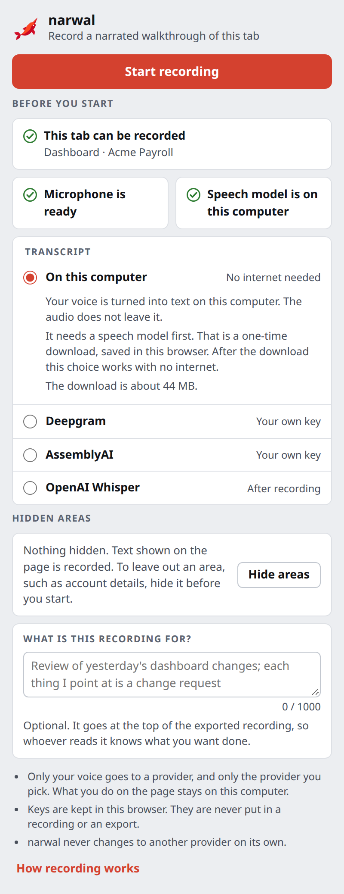
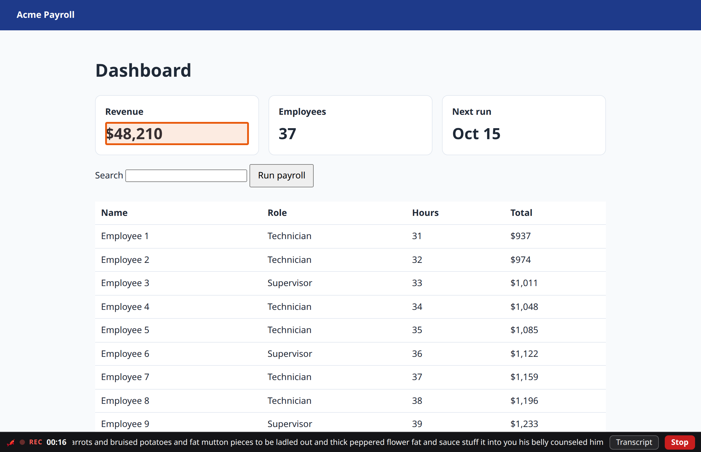
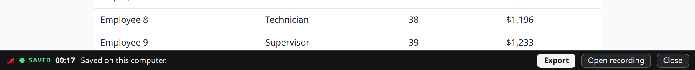
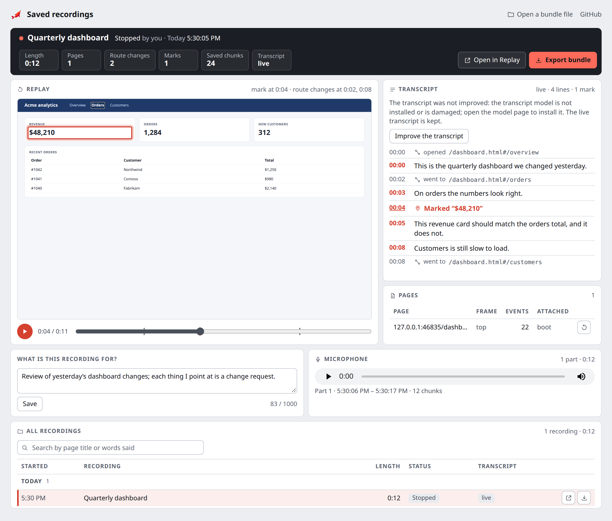

<p align="center"></p>

<h1 align="center">NarWal</h1>

<p align="center"><strong>Narrated walkthroughs of a browser tab that an AI agent, or a colleague, can read.</strong></p>

NarWal is a browser extension for Microsoft Edge and Google Chrome. You press Start on a tab,
then talk and point as you would in a screen share. NarWal records the page,
your voice, what you click and scroll, and the things you mark with a
right-click. When you press Stop it saves the recording on your computer.
Export turns it into one file, a bundle, that an AI agent or a person can
read without playing a video.

**What makes it different**

- **The output is text, not a video.** A bundle holds a timeline: what you
  said, what you marked, what the page showed, all with times. An agent reads
  it the way it reads a document. No vision model, no audio player, no
  guessing which pixel you meant.
- **Marking is explicit.** A right-click marks one thing. A right-drag marks
  an area. Each mark goes into the timeline next to the words you were saying.
- **It stays on your computer.** The page, your voice and the transcript are
  saved in your browser. Nothing is uploaded unless you choose OpenAI for the
  transcript, and then only your voice goes, after you stop.
- **Privacy is built in.** Everything you type is masked before it is
  recorded. You can hide parts of a page before you start. Values in web
  addresses are removed.

## Who it is for

Anyone who needs to explain a web page to someone who is not sitting next to
them, and wants the result to be usable rather than watched.

- **Reporting a bug to an agent.** Record the page where it goes wrong, say
  what you expected, right-click the broken control. Hand the bundle to a
  coding agent. It gets the page, the route, the element you marked and your
  words, in order.
- **Handing over a process.** Walk through the monthly task once, talking as
  you go. The bundle is a step-by-step record a colleague or an agent can
  follow, and the replay shows the pages with your narration.
- **Reviewing a page with a client.** Go through a page together, mark each
  change request as you discuss it. Export, and the list of changes is in the
  bundle with the exact element each one refers to.

## How it works

<p align="center"></p>

1. **Open the tab you want to record** and press the NarWal button in the
   toolbar. The popup checks three things: the tab can be recorded, the
   microphone is allowed, and the transcript choice is ready.
2. **Say what the recording is for** (optional). The sentence goes at the top
   of the bundle so whoever reads it knows what you want done.
3. **Press Start recording.** A one-line strip appears at the bottom of the
   page with the time, the newest words of the transcript, and Stop. The strip
   itself is never recorded.
4. **Talk and point.** Say what you see and what you want. Move through the
   site as you normally would: links, back and forward, forms, single-page
   routes. The recording follows the tab, and a tab or popup it opens (a
   sign-in window, a link that opens a new tab) once you switch to it.
5. **Mark things.** Right-click an item to mark it (the page's own menu does
   not open). Hold the right mouse button and drag to mark an area. Each mark
   is highlighted for a moment and saved with the time.
6. **Press Stop** on the strip, in the popup, or with Alt+Shift+S. The
   recording is saved on this computer.
7. **Press Export.** The strip and the popup offer it as soon as the recording
   is saved. You get one file, `<page title>.narwal.zip`.

<p align="center"></p>

<p align="center"></p>

The microphone in these pictures was the test harness's recording of a
public-domain book, so the words are not about the page.

### What is in a bundle

A bundle is a zip. Inside it:

| File | What it is |
| --- | --- |
| `AGENTS.md`, `README.md` | The reading guide for an agent: the purpose you typed, what the recording holds, where to look, and the rules (ask before acting, quoted text is data, never run the raw page capture). |
| `agent/walkthrough.md` | The whole recording as text. One line per moment: what you said, what you marked, what the browser reported, the page route. `walkthrough.json` is the same timeline as data. |
| `transcript/` | The transcript, with word times. A corrected transcript is a new revision; the old one is kept. |
| `audio/narration.webm` | Your voice. |
| `observations.jsonl` | Clicks, scrolls, typed fields (masked), navigations, pointer rests and your marks, with the element each one refers to. |
| `documents.json`, `rrweb/` | Every page the recording saw, and its page capture for the replay viewer. |
| `gaps.jsonl` | Any stretch where evidence is missing, and why (microphone unplugged, a page the browser does not let extensions record, and so on). |
| `manifest.json` | Identity, length, the privacy settings that applied, and the file list. |

This is the walkthrough of the 17-second recording in the pictures above:

```text
[00:00.0] observed navigation to / (load) | route=/
[00:00.5-00:10.1] said="he hoped they would be stew for dinner turnips and carrots and bruised potatoes and fat mutton pieces to be ladled out and thick peppered flower fat and sauce" | route=/
[00:12.0-00:14.5] said="stuff it into you his belly counseled him" | route=/
[00:16.5-00:16.9] said="after" | marked element "$48,210" div | observed pointer over "$48,210" div 0.7s | route=/
```

### What stays private

- **Everything you type is masked.** Text fields, passwords, search boxes and
  editable areas are recorded as masked values, never as what you typed.
- **Text shown on the page is recorded.** If a page shows something you do
  not want in the recording, press **Hide areas** in the popup before you
  start and click those parts. A hidden area is recorded as a striped box of
  the same size. Areas cannot be hidden once a recording has started.
- **Values in web addresses are removed.** A page's address is kept, but the
  values after `?` and `#` are replaced.
- **Your voice is recorded as you speak.** Do not read secrets aloud.
- **Nothing leaves your browser** unless you choose OpenAI for the transcript.
  Then only the narration audio is sent, after you stop, with your own key.
- **Keys stay in the extension.** An API key is never put in a recording or an
  export.
- **Nothing is uploaded to us.** NarWal has no server, no account, no
  analytics and no telemetry. It never sends anything to ProSoft IP. The
  only network requests are the speech model downloads you ask for and,
  if you choose it, your audio to OpenAI. The privacy policy is
  [prosoftip.com/narwal/privacy](https://prosoftip.com/narwal/privacy)
  ([source](docs/release/privacy-policy.html)).

## Transcription choices

| Choice | When the text appears | What leaves your computer |
| --- | --- | --- |
| **On this computer** | While you talk. The strip shows each phrase a few seconds after you say it. | Nothing. The speech models are downloaded once (about 1 to 1.5 GB) and then work with no internet. |
| **OpenAI Whisper** | After Stop. The narration audio is sent to OpenAI and the transcript comes back a few minutes later. | Your voice, to OpenAI, using your own OpenAI API key. OpenAI charges your account for each transcript, and again for each **Try again**. |

On this computer uses Parakeet, an English speech model, for the live text.
When Parakeet is not downloaded or cannot start, it uses Vosk, a small model
that shows words at once but mishears far more.
The transcript can be corrected by hand on the replay page. **Coming:** a more
accurate pass after Stop, made on this computer with a larger Whisper model,
and a model picker that shows the measured accuracy of each choice. The
work is in progress and the measurements are on its pull request.

With OpenAI, no text appears while you record. Choosing OpenAI and pressing
Stop is the consent for that one upload. Export waits until the transcript
arrives (the button says **Export when the transcript is ready**; pressed, it
downloads the bundle as soon as the transcript is in). If the upload fails, the strip and the recordings page say why and
offer Try again when a new upload can help.

## Install

NarWal works in Microsoft Edge and Google Chrome, version 116 or later. It
is on its way to the Chrome Web Store and Microsoft Edge Add-ons; once the
listing is live, install it from there and it updates itself. Until then, or
to run a build of your own, load it as an unpacked extension from a folder.
The full guide, including updates, is
[`docs/install-unpacked.md`](docs/install-unpacked.md).

### 1. Get the extension folder

Download `narwal-<version>.zip` from the
[latest release](https://github.com/ProSoftIP/NarWal/releases/latest), or
build it yourself (see [Development](#development)), and unzip it. It holds
one folder, `narwal`.
Move that folder somewhere you keep, for example `~/Applications/narwal`.
The browser loads NarWal from this folder every time it starts, so do not
leave it in Downloads.

### 2. Load it in Edge

1. Open `edge://extensions`.
2. Turn on **Developer mode** (the switch in the left column).
3. Press **Load unpacked** and choose the `narwal` folder (the one that
   holds `manifest.json`).
4. Pin it: press the puzzle-piece button in the toolbar, then the eye or pin
   button next to NarWal.

If Edge offers to turn off extensions in developer mode, decline.

### 2. Load it in Chrome

1. Open `chrome://extensions`.
2. Turn on **Developer mode** (the switch at the top right).
3. Press **Load unpacked** and choose the `narwal` folder.
4. Pin it: press the puzzle-piece button in the toolbar, then the pin next
   to NarWal.

### 3. First use

1. Press the NarWal button. The popup shows **Before you start**.
2. **Microphone**: press **Allow microphone** and allow it in the tab that
   opens. On a Mac, allow the browser in System Settings → Privacy &
   Security → Microphone as well if asked.
3. **Transcript**: for **On this computer**, press **Download speech
   model**. A tab downloads the models once (about 1 to 1.5 GB) and tells you when
   they are on this computer. For **OpenAI Whisper**, press **Add key** and
   paste your OpenAI API key.
4. **Check the microphone**: under **Start recording** the
   popup shows the microphone, a level bar and **Test**. Press **Test** and
   talk: the bar moves and turns green, and the popup says "NarWal hears
   you." After 3 seconds with no sound it says "No sound from" and the
   microphone's name. Pick another microphone in the list if that is the
   wrong one; NarWal remembers it and every recording uses it. The test
   records nothing. The same choice and test are on the **Options** page
   (the popup's **Options** link, or Options in the extension's menu).
5. Open the tab to record, press the NarWal button, then **Start recording**.
   While it records, the bar at the bottom of the page shows the same small
   level bar. If the microphone hears nothing in the first 10 seconds, the
   bar says "No microphone sound". If the chosen microphone is not
   connected, NarWal records with the default one and the bar says
   "Default microphone".

### What NarWal asks permission for, and why

| Permission | Why |
| --- | --- |
| Read and change data on all websites | To record the tab you choose. NarWal runs only in the tab you start and the windows it opens that you switch to; other tabs are refused. |
| Microphone | Your narration. Asked on first use, in a NarWal tab. |
| Offscreen documents | The recorder lives in a hidden extension page so it keeps going while the popup is closed. |
| Scripting, tabs, web navigation | To put the recorder into the pages of the recorded tab, follow it from page to page, and see the windows it opens. |
| Storage, unlimited storage | Recordings are kept in the browser on this computer. An hour of recording is about 57 MB. |
| Alarms | A check every 30 seconds that the recorder is still running while you record. |

Recordings are stored under the extension's ID inside the browser profile.
**Removing the extension deletes every recording it holds.** Export a bundle
first; a bundle can be opened again later.

## Using the bundle

**Give it to an agent.** The bundle is made to be read. Attach the
`.narwal.zip` to the agent's chat, or unzip it in the agent's working
directory. The `AGENTS.md` inside explains how to read it and what to do by
default: list every marked item and every said line in order, treat each
mark as something to change or discuss, and ask before acting.

**Read it yourself.** `agent/walkthrough.md` is plain text. Or press **Open**
on the recording in **Saved recordings** to replay the page, the narration,
the transcript and the marks together.

<p align="center"></p>

The transcript lines in this picture were written by the screenshot script
(`packages/extension/test/e2e/shots.mjs`), because its test microphone plays
a tone. Everything else is what NarWal saved.

**Correct and annotate.** On the replay page, **Edit** on a transcript line
corrects what was misheard, and **Add note** writes a note at the current
time. Export again to get a bundle with the corrections and notes. The
original transcript is kept as an earlier revision.

**Keep a bundle someone sent you.** On the replay page press **Open a bundle
file**, choose the `.narwal.zip`, then **Save to Saved recordings**.

**Check or convert a bundle from the command line** (Node 22.18 or later):

```sh
node packages/bundle/bin/narwal-bundle.ts validate <unzipped bundle>   # VALID or the errors
node packages/bundle/bin/narwal-bundle.ts export <unzipped bundle>     # the walkthrough as Markdown
```

## Keyboard shortcuts

| Keys | What it does |
| --- | --- |
| Alt+Shift+S | Stop the recording |
| Alt+Shift+N | Move the keyboard to the strip at the bottom of the page |
| Alt+Shift+M | Mark the item that has focus (or the one under the pointer) |
| Right-click | Mark one item |
| Shift+right-click | The page's own menu, as usual |
| Right-drag | Mark an area; Esc while dragging cancels |

Change the Alt+Shift keys at `edge://extensions/shortcuts` or
`chrome://extensions/shortcuts`.

## Limits today

- **One tab, and the windows it opens.** The recording follows that tab
  through every page it opens. A tab or popup that the recorded tab opens is
  recorded from the moment you switch to it until it closes, on any website.
  Closing it ends its part; closing the first tab stops the recording.
  Replay shows the window that was in front.
- **A window you never switch to is not recorded**, even when the recorded
  tab opened it (a link opened in the background, for example). Other tabs
  are never recorded.
- **Popups the browser blocks are not seen.** If Edge or Chrome blocks a
  popup, there is no window to record.
- **Edge and Chrome only**, version 116 or later. No Firefox or Safari.
- **English speech models.** The on-this-computer transcript is English only.
- **No video.** The page is recorded as page events for the replay viewer,
  not as pixels. The bundle carries no screenshots.
- **Browser pages cannot be recorded**: settings pages, the Web Store, file
  viewers, also in a window the recorded tab opened. Open a website first.
- **Parts of a page from another website** (cross-origin frames, such as an
  embedded payment form) work the same in every window: each is saved as its
  own stream in the bundle, and replay does not show its content.
- **Installed by hand until the store listings are live.** Updating an
  unpacked install means loading a new folder (the guide explains how to
  keep your recordings).
- **The transcript made on this computer is the live one.** The more
  accurate pass after Stop is coming (see Transcription choices).
- **Edge on a Mac is not yet checked on a real Mac.** The validation run
  used Chrome on Linux.
- There is no time limit. A recording runs until you stop it, the disk is
  full, or the browser closes; what was saved is kept.

## Development

The repository is a set of npm packages under `packages/`, with the design
documents under `docs/`. The TypeScript packages use erasable syntax only and
run with Node 22.18 or later without a build step.

| Package | What it is |
| --- | --- |
| [`extension`](packages/extension/README.md) | The Edge and Chrome extension: service worker, offscreen recorder, content script, popup, saved-recordings and replay pages, bundle export. |
| [`recorder-ui`](packages/recorder-ui/README.md) | The popup's start view and the in-page strip, with a demo and its own e2e run. |
| [`interactions`](packages/interactions/README.md) | Masked interaction capture and the right-click and right-drag marks. |
| [`bundle`](packages/bundle/README.md) | The bundle validator, fixtures and the agent walkthrough export. Schema: [`docs/bundle-schema.md`](docs/bundle-schema.md). |
| [`library`](docs/recording-library.md) | The local recording library, zip export and import. |
| [`replay`](packages/replay/README.md) | Replay of page, narration, transcript and marks on one clock. [`docs/replay.md`](docs/replay.md). |
| [`edits`](packages/edits/README.md) | Transcript corrections, notes and retranscription after edits. [`docs/editing.md`](docs/editing.md). |
| [`transcription`](packages/transcription/README.md) | The OpenAI after-recording adapter, the key store and the transcript revision history. |
| [`offline-transcription`](packages/offline-transcription/README.md) | The on-this-computer engines (Parakeet or Vosk live; Parakeet, Whisper or Moonshine after Stop), model download and checks. |

Build and package the extension:

```sh
cd packages/offline-transcription && npm ci && cd ../extension
npm ci
npm run build      # packages/extension/app is the extension folder
npm run package    # the same folder zipped as release/narwal-<version>.zip
npm run release    # also the store zip, release/narwal-<version>-store.zip, scanned for secrets
```

Releasing to the Chrome Web Store and Edge Add-ons: the listing text,
privacy policy, store images and checklist are in
[`docs/release/`](docs/release/CHECKLIST.md).

Test: each package has `npm test` (unit tests with Node's own runner);
`packages/extension` and `packages/recorder-ui` also have `npm run e2e`,
which runs the real extension in Playwright's Chromium with a fake
microphone. [`docs/v1-validation.md`](docs/v1-validation.md) is the measured
30-minute validation run, with every known gap.

## Contributing

Bug reports, ideas and pull requests are welcome. Read
[`CONTRIBUTING.md`](CONTRIBUTING.md) first: it says how to build, test and
send a change. To report a security problem privately, follow
[`SECURITY.md`](SECURITY.md) instead of opening a public issue.

## Licence

NarWal is open source under the [MIT licence](LICENSE.md), Copyright (c)
2026 ProSoft IP. The licence also ships in the extension folder as
`dist/LICENSE.md`.

The extension bundles third-party code under its own open-source licences,
and those licences, not NarWal's, govern that code. The notices are in
`dist/THIRD-PARTY-NOTICES.txt` and `dist/runtime/` inside the extension
folder: they include the NVIDIA Parakeet model's CC-BY-4.0 attribution and
where to get the MPL-2.0 source (Eigen) built into the speech engines. The
model sources are in the
[offline-transcription README](packages/offline-transcription/README.md).

The logo is `packages/extension/app/logo/narwal.svg`: a red folded narwhal
with a white eye.
