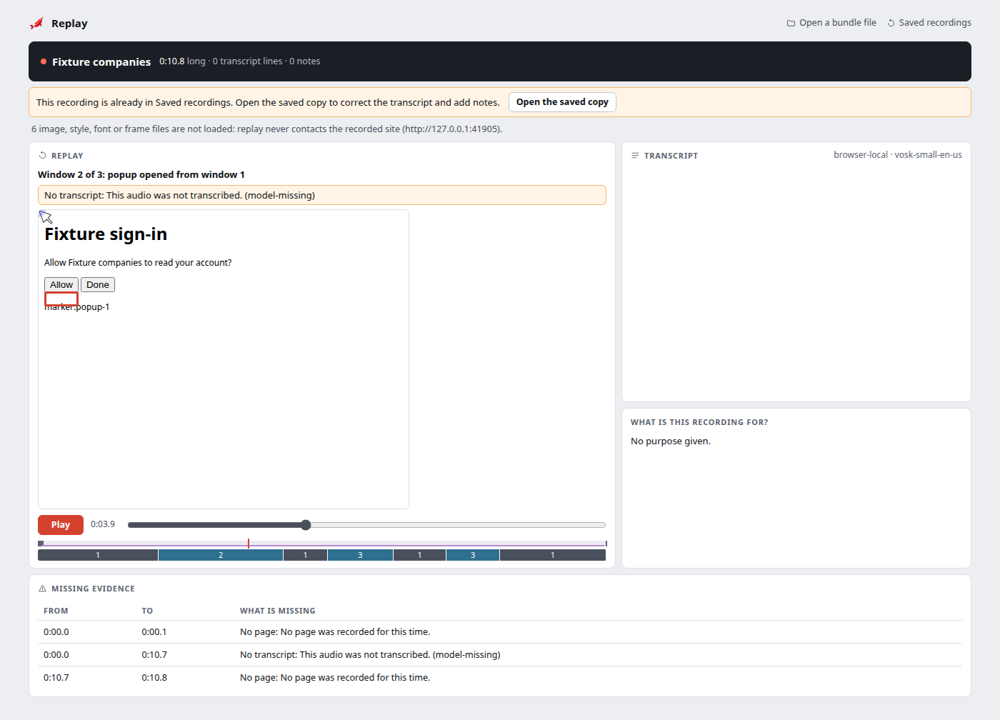
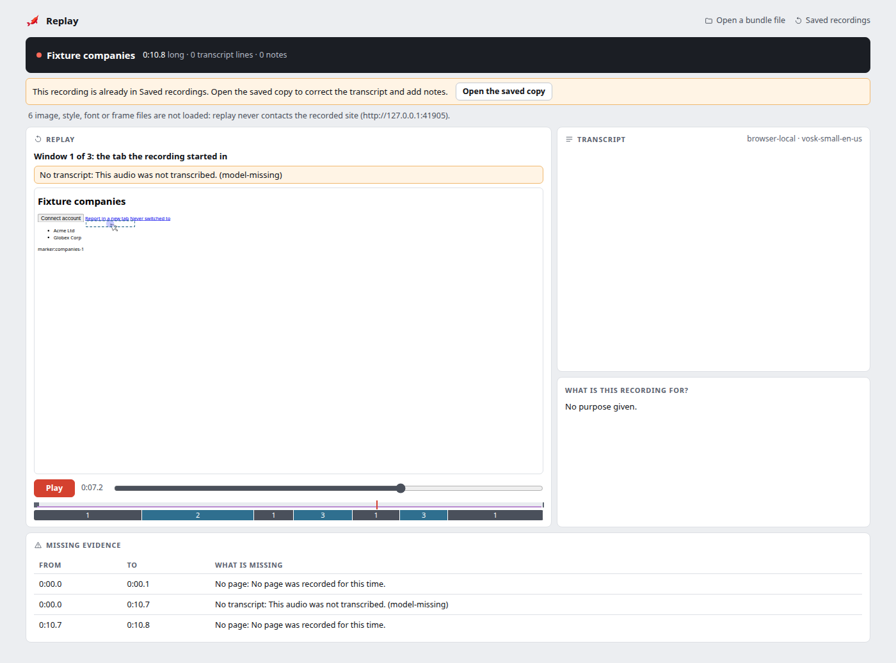

# Replay

Board #16549. The extension replays a recording with its page, narration,
transcript and markers in step: `app/replay.html`, code in `packages/replay`.
It opens a recording from the local library (`replay.html?id=<id>`) or a
`.narwal.zip` the user picks or drops on the page. A picked file is replayed
first and saved only when the user presses **Save to Saved recordings**
(section "Saving an opened file").

Board #27484: someone else's recording opens with **Open a shared recording**
(the header link, the tile shown while no recording is open, Saved recordings
and the popup) or a drop of the `.narwal.zip` on this page or Saved
recordings. Saved recordings picks the file itself and hands it over:
`replay.html?shared=1` takes it from the extension's IndexedDB
(`packages/extension/src/ui/shared-file.js`), deletes it there and drops
`shared=1` from the address.

## One clock

Session time (ms from recording start, `docs/bundle-schema.md`) drives
everything:

| Part | How it is placed |
| --- | --- |
| Page | rrweb events, at `timestamp − originEpochMs`, grouped by document. |
| Narration | `clock.jsonl` pairs fitted to one line per clock run: one shared slope (the device drift), one intercept per run. A run ends where the pairs jump by more than 250 ms; the new run starts where the recorded audio gap ends. |
| Transcript | The active revision through the bundle's own agent view (`buildAgentView`), with corrections applied. Every adapter that writes the shared transcript contract replays the same way. |
| Markers | Observations: a click for 0.6 s, an element marker for 2 s, a dwell for its span, a region for its span (at least 2 s). Notes are listed and seek. |

Seeking rebuilds the page at exactly that time (rrweb `pause(offset)`) and
moves the narration to its fitted position. While playing, the clock follows
the narration whenever it is moving, so the audio's start-up and seek delays
are not error. The page runs on rrweb's own timer and is corrected only when it
is more than 60 ms from the clock.

## Tolerances

Both come from the capture probe (`research/capture`, #16538):

| Constant | Value | Evidence |
| --- | --- | --- |
| `PAGE_TOLERANCE_MS` | 5 ms | Content script to recorder latency, max 4.6 ms. |
| `AUDIO_SYNC_TOLERANCE_MS` | 60 ms | Audio clock fit residual, max 52 ms. |

The known-timing fixture (`packages/replay/test/known-timing.ts`) has a
navigation at 12 s, a pause from 20 s to 21 s, a microphone loss from 24 s to
25.5 s, 270 ppm clock drift and ±25 ms pair jitter. Its page shows `tick N` in
second N; its narration (`fixtures/known-timing.webm`) beeps on each media
second. Tests seek 5 ms each side of every change. Measured in Chromium
(`npm run e2e:replay`, 2026-10-13):

| Check | Worst |
| --- | --- |
| Narration after a seek | 8.5 ms |
| Narration while playing, through the navigation and the pause | 8.4 ms |
| Page while playing | 38 ms |

## Gaps

Nothing missing is drawn as if it were there.

| Effect | Shown as | From |
| --- | --- | --- |
| No page | The page is covered and the reason is given. | `restricted-page`, `navigation-blind-window`, `injection-failed`, `recorder-paused`, `recovery-truncated`; time with no document (`no-page-evidence`) |
| Page incomplete | Banner over the page. | `lost-messages`, `tab-hidden`, frame gaps |
| No narration | Banner; the audio is silent. | Audio gaps; a recording with no audio (`no-narration`) |
| No transcript | Banner. | Transcript revision gaps |

Every gap is a band on the timeline and a row in the gap table; both seek.
Images, styles, fonts and frames the page used are never loaded; the count and
their sites are shown above the player.

## Windows

Board #16754. A recording can hold more than one window: the tab it started
in, and each tab or popup that tab opened once the person switched to it
(`docs/bundle-schema.md` §5). Replay shows one window at a time, the one in
front at that moment, from the `window` observations: the first window at
0, then each `opened` and `focused` window; a window that closes in front
hands back to the one that opened it. When the window in front has no page
at that time, the page of another window is shown, unless a no-page gap of
the window in front explains why.

Under the timeline, a strip has one band per stretch of time a window was in
front, numbered by window; a click seeks. The line under it names the window
shown (`Window 2 of 3: popup opened from window 1`). A no-page gap of one
window (a restricted page in a popup) covers only that window's page. A
recording of one window has no strip and no line.

## Saving an opened file

Board #16589. A picked file opens for viewing only: it cannot be edited and
nothing is stored. Under its title the page offers one action:

| The file is | Offer | Result |
| --- | --- | --- |
| Not saved here | **Save to Saved recordings** | `RecordingLibrary.importBundle` checks the whole archive again (`docs/recording-library.md` section 3, with the `@narwal/bundle` validator) and adds it; a failed check stores nothing. The page then opens the saved copy (`replay.html?id=<id>`). |
| Already saved (same bundle contents, or saved from this same file and edited since) | **Open the saved copy** | Opens it. No second copy is made. |
| Saved, then put in the trash | **Restore it and open it** | Restores and opens it. |

A saved copy is a library recording with origin `imported`: the Saved
recordings page lists it with status "from a bundle file", **Open** replays
it here, it takes corrections and notes (`docs/editing.md`), and **Export
bundle** packs it again with them. It stays after a browser restart.

Picking a file while a library recording is open shows the file; edits are
off until the file is saved, so they cannot reach the other recording.

The e2e `keep` scenario checks each line above, a browser restart, a file
changed after export (refused, nothing stored), and that a saved hostile
bundle stays as inert as an opened one.

## Isolation

A bundle is untrusted, including one from the local library.

1. The bundle is validated in full (`validateBundle`) before anything is
   drawn. A changed file fails its checksum and nothing replays.
2. rrweb rebuilds the page in a frame sandboxed with `allow-same-origin` only.
   No recorded script, event handler or `javascript:` link runs, and the frame
   cannot navigate. The player refuses a frame with any other sandbox.
3. Every replay page has the content security policy `REPLAY_CSP`
   (`packages/replay/src/sandbox.ts`): no network loads, no frames, no
   workers, no forms. The replay frame inherits it, so recorded markup cannot
   fetch from the recorded site, with or without the user's cookies.
4. All bundle text (titles, transcript, notes, gap details) is set with
   `textContent`.

The e2e `hostile` scenario replays a bundle with inline and external scripts,
event handlers, a `javascript:` link, meta refresh, `<base>`, stylesheets,
`@import`, fonts, images, `srcset`, media, `object`, `embed`, `iframe`,
`srcdoc`, a form and SVG images, all aimed at a local site holding a session
cookie. It checks that the site received zero requests (and that the same
counter does count an ordinary visit), that nothing ran in the extension page
or the frame, and that nothing reached extension storage.
